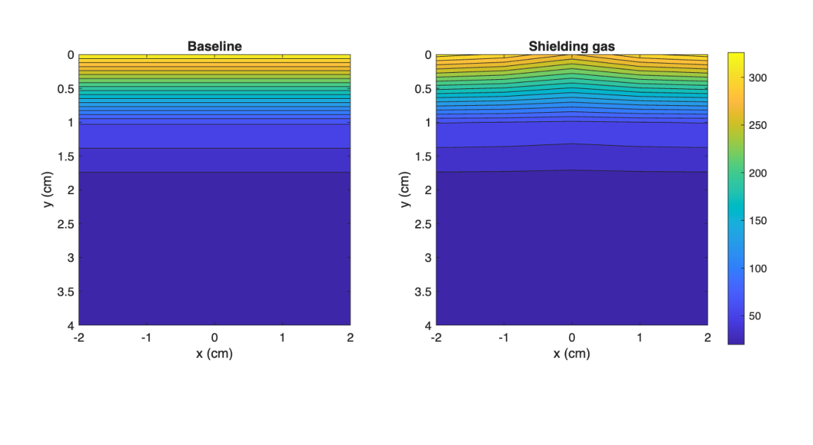
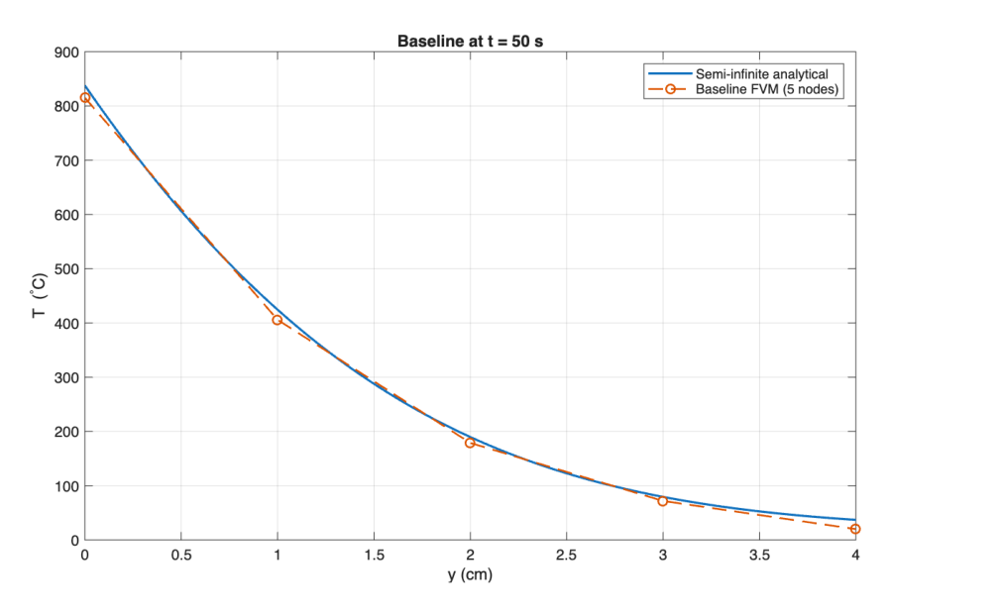

# Transient Heat Conduction During Laser Heating

**Finite-volume heat transfer · MATLAB · Stainless steel 316L · DTU 41814 (Autumn 2026)**

A **group coursework project** investigating the temperature field in a steel plate exposed to a constant laser heat flux, with and without a spatially varying shielding-gas cooling jet. We used an explicit finite-volume formulation, examined time-step stability, and compared the numerical baseline with the semi-infinite analytical solution.

> **Attribution and scope:** This is a five-student DTU team project, **not** an individual research paper. Guillaume Saint-Pierre contributed to the MATLAB implementation, performed the 50-second numerical/analytical comparison, and helped write and review the report. The original report discloses use of Claude for assistance with code, figures, derivations, sources and typesetting; see [contributors and disclosure](docs/CONTRIBUTIONS_AND_DISCLOSURE.md). Temperatures are **computed predictions**, not measurements.



## Engineering problem

A **4 cm × 4 cm** 316L stainless-steel cross-section starts at **20 °C**. A **3,000 W** laser with a **2 cm** spot radius and **35%** surface absorptivity provides a uniform absorbed surface flux over the top boundary of the simplified model. The sides are insulated and the bottom is maintained at 20 °C. A second case adds a shielding-gas jet with a stronger heat transfer coefficient near the centre.

We solve the transient two-dimensional energy equation with a **5 × 5 nodal finite-volume grid** (1 cm spacing), an explicit **2 s** step and constant material properties. The original assignment's 2D control-volume convention uses unit out-of-plane depth.

| Quantity | Value used in the submitted report |
|---|---:|
| Absorbed laser power | 1,050 W |
| Absorbed heat flux | 0.836 MW/m² |
| Thermal conductivity, k | 16.25 W/(m·K) |
| Density, ρ | 7,889 kg/m³ |
| Specific heat, cₚ | 518.3 J/(kg·K) |
| Thermal diffusivity, α | 3.97 × 10⁻⁶ m²/s |
| Time step | 2 s |
| Grid | 5 × 5 nodes |

The published property values are interpolated near **446 K** from the stainless-steel data reference listed below. These constant properties become less representative as temperature rises.

## Selected numerical results

| Location / configuration | Computed temperature |
|---|---:|
| Upper surface at t = 10 s, laser-only | **325.9 °C** |
| Upper surface at x = 0, t = 10 s, with shielding gas | **278.7 °C** |
| Upper surface at t = 50 s, laser-only | **815.2 °C** |
| Analytical semi-infinite surface at t = 50 s | **837.9 °C** |

The shielding gas reduces the predicted centre-surface temperature by **47.2 °C** at 10 s. At 50 s, the explicit finite-volume result is **22.7 °C below** the semi-infinite analytical result at the surface. The comparison illustrates both the **coarse-grid discretization error** and the importance of the finite bottom boundary at later times; agreement does not constitute physical validation of real laser processing.



See also [centreline comparison at 10 s](figures/centerline_comparison_10s.png) and [shielding-gas coefficient profile](figures/shielding_gas_h_profile.png).

## Equations and method

For the solid with constant properties and no volumetric heat generation:

\[
\rho c_p\frac{\partial T}{\partial t}=k\left(\frac{\partial^2 T}{\partial x^2}+\frac{\partial^2 T}{\partial y^2}\right).
\]

The prescribed absorbed heat flux is \(q''_{\rm laser}=0.35(3000)/(\pi 0.02^2)\). The cooling case adds the boundary loss \(q''_{\rm conv}=h(x)(T_s-T_\infty)\), with

\[
h(x)=100+900\exp\left[-\ln(9/2)\left(\frac{x}{0.01}\right)^2\right],\quad T_\infty=20^\circ\mathrm{C}.
\]

The explicit update applies the facewise heat balances to corner, edge and interior control volumes. The worst-case coefficient-positivity criterion is **Fo ≤ 0.191** with convection (corresponding to Δt ≤ approximately 4.8 s for this grid and the report's properties). The selected Δt = 2 s is below this bound. This checks time-step stability of the stated discretization, **not spatial convergence**.

The analytical comparison uses a semi-infinite, constant-flux solution, whose assumptions differ from the finite plate with a fixed-temperature bottom boundary.

## Reproduce the calculations

**MATLAB R2016b or newer** (local functions in scripts):

```matlab
% Open MATLAB at the repository root:
run('matlab/laser_heating_fvm.m')
```

The script prints the calculated node temperatures, compares the baseline with the analytical solution at **10 s, 20 s and 50 s**, and writes plots to `figures/`.

A separate **NumPy numerical reproduction check** recovers the report's three headline values to rounding tolerance:

```bash
python3 -m pip install -r verification/requirements.txt
python3 verification/check_report_numbers.py
```

This Python check is an independently written implementation of the same stated **discrete equations**, not experimental validation and not a substitute for running MATLAB. The MATLAB file is a cleaned transcription of the PDF appendix, not a byte-for-byte copy of the team's original `.m` source; the full original source can replace it if supplied.

## Files

```text
matlab/          Cleaned MATLAB transcription of Appendix A
figures/         Cropped figures from the submitted team report
report/          Submitted team report PDF (student IDs redacted)
verification/    Independent NumPy numerical reproduction check
docs/            Method, limitations, contributors and disclosure
```

The original course assignment is **not redistributed** here; the report and repository describe the technical problem without reproducing the staff-authored exercise. The group report has students' administrative IDs removed from the public copy; contributors' names and the AI declaration are preserved. Before publicly uploading the entire team report/code, confirm that the co-authors are comfortable with its publication.

## Limitations

- Five nodes per dimension is a coarse discretization; the report contains **time-step stability** analysis, not a grid-refinement convergence study.
- Material properties are held constant despite large predicted temperature excursions, especially at 50 s.
- Radiation, melting/phase change and volumetric effects are excluded by the assignment's modelling assumptions.
- The semi-infinite solution provides a useful analytical comparison but is not identical to the finite-domain boundary-value problem.
- No experimental thermography or instrument measurements were performed.

## References

1. C. S. Kim, *Thermophysical Properties of Stainless Steels*, Argonne National Laboratory ANL-75-55 (1975). https://doi.org/10.2172/4152287
2. H. Azad, M. T. Mustafa, A. F. M. Arif, *Analytic solutions of initial-boundary-value problems of transient conduction using symmetries* (2009). https://arxiv.org/abs/0909.0785
3. [Team report (student numbers removed)](report/DTU_41814_group_report_student_IDs_removed.pdf), DTU Heat Transfer 41814, October 2026.
